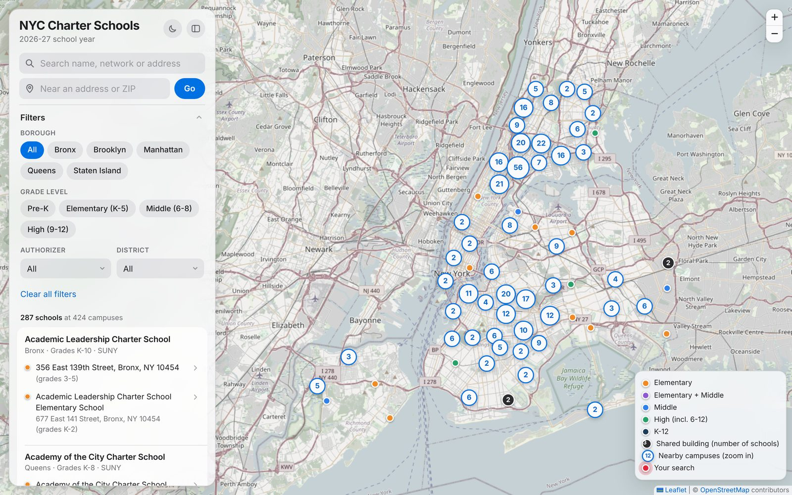
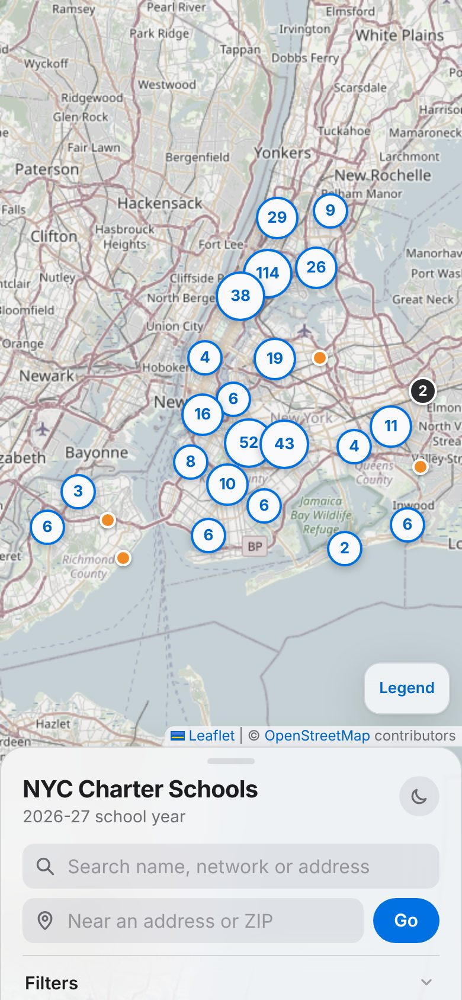
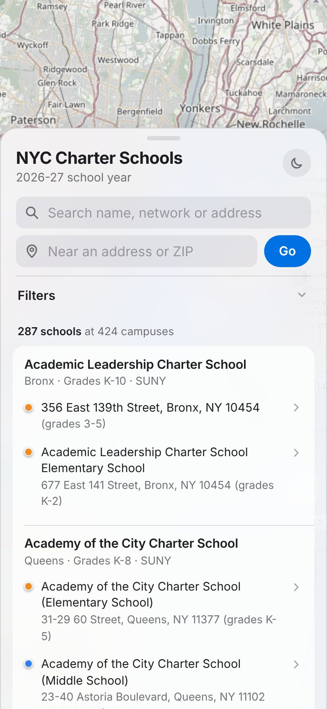
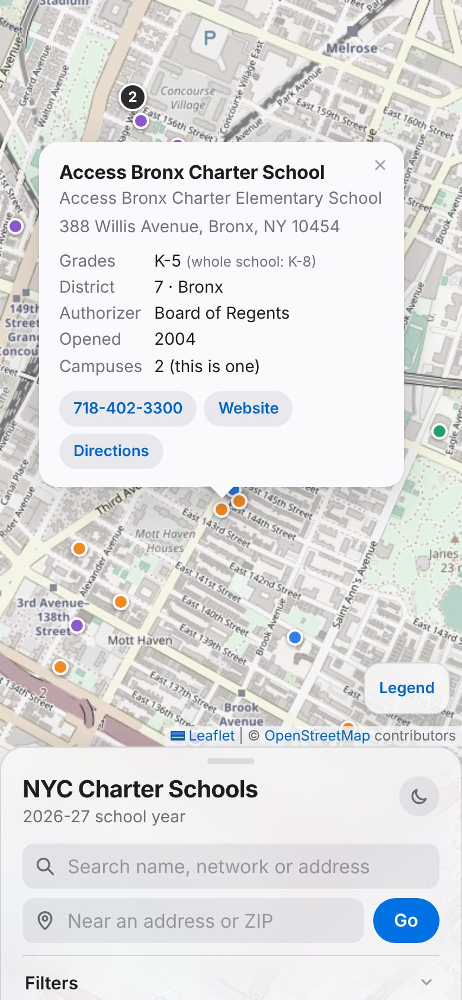

# NYC Charter Schools Map, 2026-27

**[Open the live map →](https://a7madifar7an.github.io/nyc-charter-schools-map/)** Nothing to install. Works on a phone.

Every charter school in New York City for the 2026-27 school year, at every campus: **287 schools at 424 campuses in 383 buildings**, checked against the official count and against one network's own published locations.



<table>
  <tr>
    <td></td>
    <td></td>
    <td></td>
  </tr>
</table>

## What you can do

- **See every campus.** Pins are coloured by level (elementary, elementary + middle, middle, high, K-12). Nearby pins group into a count at citywide zoom and split apart as you zoom in.
- **Reach every school in a shared building.** 34 buildings hold two or more charter schools (up to 4). They get one dark numbered pin whose popup lists each school, for example Icahn Charter Schools 3, 4 and 5 at 1500 Pelham Parkway South.
- **Search** by school name, network ("success academy"), the state's name for a school, or address.
- **Filter** by borough, grade level (Pre-K, elementary, middle, high), authorizer and school district.
- **Find schools near you.** Type an address or a ZIP code and the list sorts nearest first, with distances.
- **Click a school** for its address, grades at that campus and for the whole school, district, authorizer, year opened, phone, website and directions.
- **On a phone**, the panel is a bottom sheet: swipe up for the list, swipe down for the map. There is a light and dark mode switch.

## Why "all of them" is harder than it looks

The obvious approach is to download one file and plot it. Three problems with that:

1. **The easy files are out of date.** The NYC DOE school file on NYC Open Data is from 2017 (230 charters). The NYSED charter directory, the state's official list, still says "2025-2026" and has no addresses.
2. **One school is not one place.** The NYC Charter School Center counts 286 schools on about 420 campuses. A dot per school would leave out more than a third of the places students actually go.
3. **Several schools often share a building**, so pins sit on top of each other unless the map handles it.

## Sources

| Source | Date | What it provides |
|---|---|---|
| [NYC DOE school report (LCGMS)](https://www.nycenet.edu/PublicApps/LCGMS.aspx) | Downloaded Nov 5, 2026 | Which schools operate in 2026-27, their grades, DOE school code, one address and phone number per school |
| [NYSED Charter Schools Directory](https://www.nysed.gov/charter-schools/charter-schools-directory) | "2025-2026", file dated Sept 2, 2025 | Authorizer, year opened, the state's name for each school |
| NYSED per-school pages | Current | School websites |
| [NYC Charter School Center campus map](https://nyccharterschools.org/find-a-charter-school/) | Campus list dated Sept 18, 2025 | Every campus: address, district and grades at that campus |
| [NYC Planning GeoSearch](https://geosearch.planninglabs.nyc/) | Current | Coordinates and building ID for each address (city address database) |
| [NYC Open Data MODZCTA](https://data.cityofnewyork.us/Health/Modified-Zip-Code-Tabulation-Areas-MODZCTA-/pri4-ifjk) | Current | ZIP code areas, for "find schools near a ZIP" |
| [Charter Center, NYC Charter School Facts 2026-2027](https://nyccharterschools.org/facts-about-charter-schools/) | As of August 2026 | The official count used as the benchmark |
| [Success Academy locations](https://www.successacademies.org/locations/) | Checked Nov 2026 | Cross-check of one network's campuses ([snapshot](data/crosscheck/success_academy_locations_2026-11.csv)) |

## Definitions

- **School**: a charter school with its own DOE school code (for example `84X422`, Icahn Charter School 3). This is what the official count of 286 counts.
- **Campus**: one school at one building. A school with three buildings has three campuses.
- **Building**: one physical building, identified by the city's building ID (BIN). Several schools can share one.
- **Operating in 2026-27**: listed by the DOE for this school year with at least one grade. Schools that are approved but not yet open are not on the map.
- **NYC**: the five boroughs. Charters that the DOE lists but that sit outside the city (Mount Vernon, Long Beach) are excluded.
- **District**: the DOE community school district where the campus is.

## How the data is built

One script, [`scripts/build_data.py`](scripts/build_data.py), does all of it and writes every step and count to [`data/checks.md`](data/checks.md).

1. **Which schools operate this year:** the live DOE report. 290 charter rows; 3 excluded with reasons (2 outside NYC, 1 listed as open but with no grades and no state record). **Result: 287.**
2. **Match to the state directory** for authorizer, year opened and website: by exact state ID (268), by the 6-digit school serial number (15), by name (3), and 1 by hand. 18 schools have a different name in the DOE and state records, mostly renames (for example the Girls Prep schools are now Bronx Charter School for Excellence 6, 8 and 9). Both names are searchable.
3. **Campuses** come from the Charter Center's list. Schools that opened after it was made are placed at their DOE address. Campuses of schools that no longer operate are dropped.
4. **Corrections** that newer evidence supports are applied from [`data/overrides.csv`](data/overrides.csv), each with its reason and source.
5. **Locations:** each address goes through the city's GeoSearch and the result is checked to be the same building, not just the same street.

## Checks and what they found

**Count against the official benchmark** (Charter Center, August 2026):

| | This map | Official | Difference |
|---|---|---|---|
| Bronx | 100 | 100 | 0 |
| Brooklyn | 93 | 92 | +1 |
| Manhattan | 52 | 52 | 0 |
| Queens | 34 | 34 | 0 |
| Staten Island | 8 | 8 | 0 |
| **Total** | **287** | **286** | **+1** |

The one extra school is in Brooklyn. Two Brooklyn schools opened in 2026 (Kwenda Collegiate Girls in April, Urban Dove Team V in July), so the likeliest explanation is when each count was taken. I report the difference rather than force the total to 286.

**12 schools in the state directory are not on the map**: 9 approved but not yet open (for example Success Academy NYC 15 and 18, Achievement First 11) and 3 that no longer operate (Harriet Tubman, Harbor Science and Arts, Manhattan Charter School II).

**Locations:**

- All 424 campuses are inside NYC.
- 420 are matched to the exact building. 3 addresses are not in the city database and are placed at the nearest address on the same side of the same street; their popups say "approximate". 1 building is too new for the database and uses the coordinates the school publishes.
- No campus address is an office or mailing address (no suite, floor or apartment numbers).
- 4 source addresses named the wrong borough (for example "Manhattan, NY 10451", a Bronx ZIP); the map uses the borough the building is actually in.

**The geocoder can be wrong without saying so.** When it cannot find an address it returns another building on the same street with the same confidence score. "528 West 162Th Street" came back as 528 West 167th Street. So every result is checked against the house number and street, and typos in the sources ("Streeet", "Broadway Avenue") are fixed before lookup.

**Cross-check against Success Academy's own website.** The network publishes its 59 locations with map pins.

- 55 of the 56 locations open this year are on the map, and all 53 Success Academy campuses on the map are on its site.
- The check found 2 campuses that moved since the 2025 campus list (Bronx 5 Upper to the new Bronx K-12 building at 101 East 150th Street, and Hamilton Heights Middle School to 509 West 129th Street) and 1 campus that closed. All three are corrected in `data/overrides.csv`.
- The one gap is **Astor Place Middle School** (215 East 6th Street): no city or state record ties it to a charter school, so it is listed here rather than guessed.
- The site's own pin for Lafayette Middle School is about 900 m from its address; the city database confirms where the map puts it.

**Grades.** The DOE lists grades per school for 2026-27; the campus list gives grades per campus for 2025-26. Single-campus schools (183) use the DOE grades. For multi-campus schools, campus grades are kept where they add up to the DOE grades (72 schools). Where they do not (32 schools), the popup labels the campus grades "as of 2025-26" and shows the whole school's 2026-27 grades next to them. The DOE grade lists leave out Pre-K, so Pre-K comes from the campus list (33 campuses).

## Known limits

- **Campus list date.** Campuses come from a list dated September 2025. Moves and new campuses since then are caught for whole new schools and for Success Academy, which I checked against its own site. Other networks' 2026 moves may be missed.
- **Grades at 72 campuses** are from 2025-26 and are labelled that way.
- **Astor Place Middle School** (Success Academy) is not on the map; see above.
- **287 vs 286**: one more school than the official count, explained above.
- **Websites** are listed for 273 of 287 schools and **phone numbers** for 209; the rest have no NYSED page or no DOE phone.
- **Base map**: OpenStreetMap, free with attribution. The free tiles the plan originally used now need an API key.

## Updating the data

The data refreshes itself twice a year. A [GitHub Action](.github/workflows/update-data.yml) runs the build on **August 1** (after the DOE's July 15 update for the new school year) and **January 15**, and opens a pull request that lists schools added, removed or renamed, grade changes and campus address changes, plus the benchmark table. Nothing reaches the live map until someone reviews and merges it. If a source changes shape or a check fails, the run fails and GitHub emails the repo owner. It can also be run by hand from the Actions tab.

To rebuild locally:

```bash
pip install -r requirements.txt
```

```bash
python scripts/build_data.py --refresh
```

Without `--refresh` it reuses the downloaded files in `data/raw/`.

To view the site locally:

```bash
python -m http.server 8000 --directory docs
```

Then open http://localhost:8000.

## Files

| Path | What it is |
|---|---|
| [`data/campuses.geojson`](data/campuses.geojson) | Every campus as GeoJSON. GitHub draws it as an interactive map. |
| [`data/schools.csv`](data/schools.csv), [`data/campuses.csv`](data/campuses.csv) | The same data as tables |
| [`data/checks.md`](data/checks.md) | Every reconciliation step and check, with counts |
| [`data/overrides.csv`](data/overrides.csv) | Hand corrections, each with its reason and source |
| `data/raw/` | Snapshots of the source files, so the build can be repeated |
| `scripts/` | The build script and the change summary used by the update job |
| `docs/` | The website (plain HTML, CSS and JavaScript with [Leaflet](https://leafletjs.com/)), served by GitHub Pages |

## How I used AI

I built this with Claude Code, an AI coding agent, working step by step with check-ins: data first, then a first map, then search and filters, then design. The agent wrote the scripts and the site; I set the scope, made the calls and tested the results.

Decisions I made:

- **Map campuses, not schools**, and report 287 honestly instead of forcing the official 286.
- **Use the live DOE report** after we found the Open Data copy was from 2017 and the state directory was a year behind.
- **Check against Success Academy's own site.** This found two moved campuses and one closed one that every other source still had.
- **Push the design** from a basic layout to an Apple Maps style, add a light/dark switch, and make the phone panel swipeable.
- **Remove features that did not earn their place**: an AI chatbot (it needs an exposed API key or a server, and adds little on a static map) and a "new schools only" filter that covered just 3 schools and often showed nothing.

Where the AI got it wrong and the checks caught it:

- **Websites.** Fuzzy name matching gave 3 schools another school's website (Success Academy NYC 17 got NYC 7's). Matching now requires the numbers in the names to agree.
- **Pre-K.** Switching to the DOE's 2026-27 grades dropped Pre-K, because the DOE lists leave it out. Pre-K is now kept from the campus list.
- **Geocoding.** Results were trusted until a check showed the geocoder returning the wrong building with full confidence.
- **The theme button** first cycled through "Auto", so the first tap did nothing visible. I flagged it and it became a simple light/dark toggle.

## What I would build next

In the order I would build them, quickest and most useful first:

1. **Shareable links** that keep the current search and filters, so a parent can send a shortlist to someone else. A small change.
2. **Outcomes**: NYSED report card data (test results, attendance) linked from each school. The data is public and the map already has each school's state ID, so the join is exact. Results are per school rather than per campus, small groups are suppressed for privacy, and scores should be shown neutrally with a link to the official report card.
3. **Admissions information**: application deadlines and lottery dates, and where available, seats per grade. Dates are easy to add; seats per grade are not in any single public dataset and would have to be collected school by school.
4. **Plain-language search with AI**, for example "K-5 with Pre-K near Bed-Stuy". The AI only turns the sentence into the map's existing filters, and the results always come from the dataset, so it cannot invent a school. It needs a small server so no API key sits in the page.
5. **Automatic checks against the largest networks' websites**, not just Success Academy, so campus moves are caught each year. Each site is built differently, so AI would pull the addresses from each page and a person would review the differences.
6. **Spanish and other languages**, starting with the languages NYC public schools already translate into.
7. **Commute times** by transit or walking from a home address, instead of straight-line distance. Transit routing needs a trip planner running on the MTA's schedule data, so this is the largest piece of work. Once it exists, AI search could answer questions like "that a bus can reach".

## Credits

School data from the NYC Department of Education, the New York State Education Department and the NYC Charter School Center. Geocoding by NYC Planning GeoSearch. Map data © [OpenStreetMap](https://www.openstreetmap.org/copyright) contributors. Map library: [Leaflet](https://leafletjs.com/) and [Leaflet.markercluster](https://github.com/Leaflet/Leaflet.markercluster).
